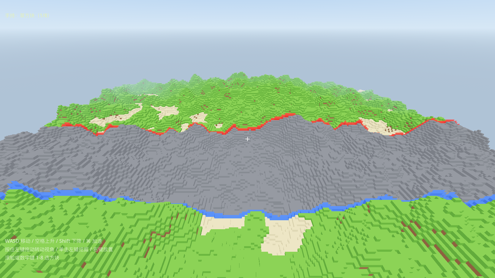

# 方块编程（暂定名）

一个 3D 体素世界 + 玩家编写单位代码的 PVP 模拟经营游戏，目标平台 Steam（Godot 4.7）。

## 现在能玩到的东西

- 256×256、高度 64 的有限世界：左右两方各 100 宽，中间 56 宽是灰色中立区（地形照常起伏，但整片换成灰色方块、禁止建造/破坏），两侧边界用贴合地形的蓝/红发光色带标出
- 程序生成地形、沙滩、矿脉
- 自由飞行视角，左键挖掘、右键放置、数字键选方块
- 内置沙箱字节码 VM：玩家写的类 Python 代码可以在游戏里安全执行，不依赖外部解释器



## 运行

```sh
# 方式一：双击 play.command（macOS）
# 方式二：命令行
/Users/boyu/Desktop/Godot.app/Contents/MacOS/Godot --path .
```

首次启动可能黑屏 30~60 秒（Godot 在这台机器上编译着色器管线缓存，之后就快了）。

操作：WASD 移动 / 空格上升 / Shift 下降 / ⌘ 加速 / 按住左键拖动转视角 / 单击左键挖掘 / 右键放置 / 滚轮或数字键 1-8 选方块。

## 测试

```sh
./run_tests.sh
```

## 目录结构

```
data/blocks/      方块定义（JSON）
scenes/main.tscn  主场景
scripts/core/     游戏入口 main.gd
scripts/world/    方块表、地形生成、体素世界（区块网格/碰撞/射线）
scripts/player/   自由视角相机
scripts/ui/       HUD
scripts/lang/     沙箱字节码 VM（词法/语法/编译/虚拟机）
tests/            headless 测试与截图工具
docs/             预览图、玩家编程手册、上架与版权清单
```

## 路线图

1. ✅ 方块世界与挖掘/放置
2. ⬜ 单位系统：部署、传感器、执行玩家代码
3. ⬜ 资源与生产：矿 → 部件 → 单位
4. ⬜ 双阵营与胜负判定
5. ⬜ 联机（服务端权威）
6. ⬜ Steam 接入（GodotSteam）
