# 方块编程（暂定名）

一个 3D 体素世界 + 玩家编写单位代码的 PVP 模拟经营游戏，目标平台 Steam（Godot 4.7）。

## 现在能玩到的东西

- 256×256、高度 64 的有限世界：左右两方各 100 宽，中间 56 宽的中立区（只是叫灰区，地形、材质、可建造性和两侧完全一样），两侧边界用一条贴合地形的蓝/红细线标出（挖方块 / 放方块时那条线会自动重铺）
- 程序生成地形、沙滩、矿脉：**煤最浅 → 铜 → 铁（更深）→ 金（最深）**，共 11 种方块
- 队伍配色：**蓝方**深蓝机身 + 青色识别条，**红方**赤红机身 + 橙色识别条；蓝方建筑是深蓝 + 青色发光带，红方是赤红 + 橙色
- **建筑不是瞬间出现的**：放下后要施工 10 秒（半透明青色"施工中"外观 + 从地基往上长），期间不产出；指挥官 AI 也会等上一栋建好再放下下一栋
- 建筑放置要求：地面必须平整（同一高度）、**每一格底下都必须踩实**（3×3 的地基缺一格都不行）、占地方块必须是空气、不能和别的建筑重叠、脚下不能站着单位
- **地基被挖穿会停工**：建筑整栋变红发暗、停止产出，把地基补回去就恢复
- **物流链（新）**：仓库把资源上限从 400 抬到 1000（每座 +600），精炼厂把 2 铁 + 2 煤炼成 1 钢，车辆厂用钢产车车，货运飞飞专门给前线送电
- **新单位**：建筑工（代码里用 `place(方块, x, y, z)` 往世界放方块）、自爆无人机（贴近敌人自动爆炸，6 米 150 伤）、布雷车（每 2 秒埋雷）、维修无人机（半径 9 回血 14/秒）、干扰机（移动干扰塔）、钻地机（4 格长钻头）、平台无人机（半径 14 给友军回电）、侦察机（高速、雷达 26 格，专门侦察）、货运飞飞（用 `transfer(True)` 给附近友军输电）
- **新建筑**：雷达站（给全队共享 30 格视野）、维修厂（半径 12 内友军持续回血）、仓库、精炼厂、车辆厂、传送带（给 6 米内矿机/工厂加速 +30%，最多叠 3 条）、指挥中心（被拆直接判负）、护盾发生器（按伤害吸电）、干扰塔（压制敌方代码速度），都要吃电
- **能源网（新）**：发电站烧煤产电，储能站提高电力上限，充电站和哨戒炮塔都要吃电——没电就罢工、头顶显示停机图标
- **哨戒炮塔（新）**：自动打 14 格内最近的敌方单位，耗电 20/发，打不到目标会自己转炮管
- **建筑有血量**：采矿机 260 / 组装厂 320 / 充电站 220 / 发电站 300 / 储能站 200 / 炮塔 260，激光和炮弹都能把建筑打掉
- **头顶状态图标**：单位没电、建筑被方块埋住、地基不牢、代码停机时，头顶会浮出一个程序化生成的图标（闪电 / 方块红叉 / 橙色警示三角 / 红色感叹号），不用点开面板就能看到哪里出问题
- **不能和方块重叠**：占地体积里只要有方块（后来被别人堆进去也算）整栋立刻罢工变红，清出来才继续
- 施工时有从下往上的剖面切割动画（切口发光），像盖楼一层层往上起
- 采矿机不再只挖脚下 3×3 竖井，而是在半径 12、深 24 的矿区里扫矿，矿挖完了经济不会断
- 开局资源：两边各自一套（铜 200 / 煤 200 / 铁 40 / 金 10），不会互相抢
- 红蓝双方跑**同一套指挥官代码**（`COMMANDER_SOURCE`）：开局造矿机/组装厂/充电站，100 秒后指挥官亲自带兵压上；谁赢看谁先把经济滚起来
- 开局双方各一台飞飞；**蓝方**跑「指挥官 AI」：发育期盖矿机 + 两座组装厂，靠产线滚雪球（3 个种子实测都是蓝方赢）；红方是简单的战斗 AI
- 自由飞行视角；玩家不直接挖/放，而是**标记虚影**（左键挖、右键放、B 建、N 拆），由单位的代码去执行
- 单位移动用 **A\* 寻路**：代码里 `go_to(x, y, z)` 就能自动绕过地形飞过去
- 两台预设单位：**飞飞**（0.75 米悬浮无人机：矢量喷口 + RCS + 激光钻头 + 机背炮管 + 雷达）和 **车车**（地面轮式工程车：四条轮子、车头钻头；只能在地面跑），T 键切换、F 放置、G 收回
- 预设单位「飞飞」：0.75 米立方的小型无人机，底部矢量喷口 + 两侧 RCS + 前置激光钻头 + 机背炮管 + 顶部雷达；F 放置、G 收回
- 内置沙箱字节码 VM：玩家写的类 Python 代码可以在游戏里安全执行，不依赖外部解释器
- 代码面板（C 键，贴在屏幕右侧）：上面选单位、中间编辑代码、下面看状态/错误/print 输出；列表里只有自己的单位
- 双击屏幕上的本方单位 → 直接打开它的代码
- 单位代码分 `start()`（跑一次）和 `loop()`（一直跑）两段，每秒 60 行；教程见 [docs/飞飞快速上手.md](docs/飞飞快速上手.md)
- 资源：挖矿得煤矿/铜矿，放单位扣资源，收回退款
- 厂房产出可切换：准星对准厂房按 **P** 循环切换（组装厂：飞飞/侦察机/炮艇/维修机/平台机；车辆厂：车车/布雷车/钻地机/自爆机），新下线的单位会自动用**它自己的预设代码**
- 建筑（M4）：Q 切换、B 对准地面标记建造、N 标记拆除；真正施工也要单位代码读到标记去做。**采矿机**每 1.2 秒挖掉脚下一块矿；**组装厂**每 18 秒花掉一台飞飞的造价，直接在旁边下线一台；**充电站**每 0.5 秒给半径 14 米内的己方单位充电 900W
- 两队对抗：开局蓝红各 1 台飞飞自动对局（红方是脚本 AI），一方单位清零即分胜负，R 重开
- **开局 60 秒发育时间**：屏幕上显示倒计时，这期间激光、炮、钻头都打不到对方单位，只能挖矿/造建筑/写代码；倒计时结束后才能开打
- 启动流程：加载遮罩 + 「正在生成世界 xx%」，建完才开局（约 2 秒），期间不响应操作

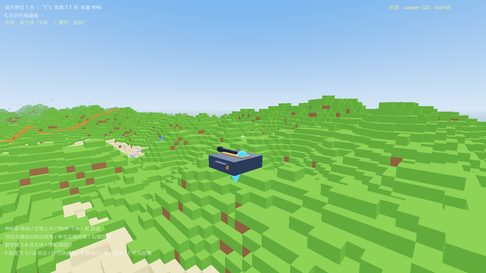
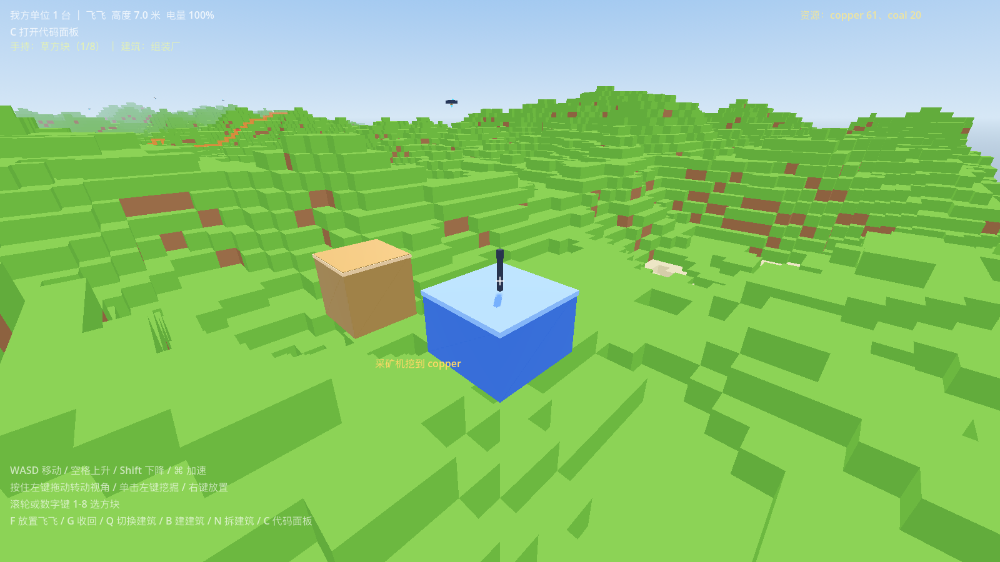


## 运行

**推荐：双击 `PlayGame.app`** —— 不开终端窗口，游戏退出后进程自己结束，不会留下终端窗口。

也可以用 `play.command`（双击运行，游戏退出后会自动关掉那个终端窗口），或者命令行：

```sh
/Users/boyu/Desktop/Godot.app/Contents/MacOS/Godot --path .
```

首次启动可能黑屏 30~60 秒（Godot 在这台机器上编译着色器管线缓存，之后就快了）。

开发提示：`shaders/` 里放着自定义着色器（如施工剖面 `construction.gdshader`）。

**每局地形都是新的**（随机种子）；想复现某张图：`--path . -- --world-seed=12345`。

操作：WASD 移动 / 空格上升 / Shift 下降 / ⌘ 加速 / 按住左键拖动转视角 / 单击左键标记挖掘 / 右键标记放置 / 数字键 1-8 选方块 / Q 切换建筑 / B 标记建造 / N 标记拆除 / 滚轮调视野 / C 代码面板（或双击本方单位）/ T 切换单位 / F 放置单位 / G 收回单位 / R 重开 / Tab 队伍面板 / P 切换厂房产物。

## 测试

```sh
./run_tests.sh      # 24 套 headless 测试（VM/世界/单位/经济/建筑/战斗/联机…）
```

截图脚本在 `tests/preview/`，每个脚本会在 `docs/` 下生成对应的预览图。

## 预设代码（可改本地文件）

每种单位的默认 AI 代码放在 `data/presets/<单位id>.py`：

| 文件 | 对应单位 |
| --- | --- |
| `feifei.py` | 飞飞（僚机） |
| `commander.py` | 指挥官（开局造建筑的那台） |
| `gunship.py` / `scout.py` / `cargo.py` / `builder.py` / … | 对应单位 |

- 想让某个单位用不同 AI：直接改对应 `.py`，**下一个部署/下线的单位就会用新代码**（按文件修改时间自动重载）
- 指挥官支持按队伍分开写：放 `commander_blue.py` / `commander_red.py` 就会优先用它们（没有就退回 `commander.py`）
- 文件不存在时自动回退到脚本里的内置常量，所以删文件也不会崩

## 目录结构

```
data/blocks/       方块定义（JSON，11 种）
data/units/        单位定义（飞飞 / 车车）
data/buildings/    建筑定义（采矿机 / 组装厂 / 充电站）
scenes/main.tscn   主场景
scripts/core/      游戏入口 main.gd、材质缓存
scripts/world/     方块表、地形生成、体素世界（区块网格/碰撞/DDA 射线）、A* 寻路、程序化贴图
scripts/units/     飞飞、车车、单位控制器（跑玩家代码+注入传感器）、预设代码（presets/）
scripts/buildings/ 建筑实体与建筑表
scripts/economy/   资源账本与生产
scripts/net/       联机协议、快照、UDP 会话、主机端管理器
scripts/ui/        HUD、代码面板、联机面板
scripts/player/    自由视角相机
scripts/lang/      沙箱字节码 VM（词法/语法/编译/虚拟机）
shaders/           施工剖面等自定义着色器
tests/             headless 测试（*_test.gd）
tests/preview/     截图脚本（生成 docs/ 里的预览图）
docs/              预览图与玩家/开发文档
```

## 路线图

1. ✅ 方块世界与虚影标记（挖掘/放置/建造由单位代码执行）
2. ✅ 单位系统：飞飞 / 车车、传感器、执行玩家代码（沙箱 VM）
3. ✅ 资源与生产：矿机采矿 → 组装厂产单位 → 充电站补电
4. ✅ 双阵营与胜负判定（60 秒发育期 + 钻头/激光/火炮）
5. ✅ 联机（服务端权威、20Hz 快照、M 键面板）
6. ⬜ Steam 接入（GodotSteam 打包、成就、商店页）

更细的拆分见 `docs/路线图.md`；上线前的素材/字体/商标风险见 `docs/上架与版权清单.md`。

## 预设单位

两台预设单位，玩家自己写代码指挥（T 键切换、F 放置、G 收回）。

### 飞飞（0.75 米立方飞行器）

- 机身：底部一个可偏转的矢量喷口（升力 + 侧移），左右各一个 RCS 吊舱（前后两个喷口，负责平移和转向）
- 机头：激光钻头，按控制指令每隔 0.25 秒朝正前方挖掉一个方块
- 顶部：小雷达，输出自身周围 5×5 的地表、5×5×5 的方块、10 格内的敌方单位（坐标/类型/血量/距离）
- 武器：`laser(x,y,z)` 8 格持续激光（对块 80/s、对单位 45/s）、`shoot(x,y,z)` 15 格炮击（对块 60、对单位 70，冷却 0.7 秒、每发 2400 焦耳）
- 参数：12kg / 500kJ 电池 / 血量 90 / 升力 520N / RCS 60N / 喷口偏转 ±24° / 钻孔 1.5m、0.25s 一次
- 造价：铜 18 + 煤 8
- 方块有血量：草/泥土/沙 18、木板 36、石头 42、煤矿 60、铜矿 72、铁 96、金 108、基岩打不动

### 车车（1.2 米立方地面工程车）

- 四个轮子 + 车头钻头；`set_rcs(转向, 油门)` 开车（飞行指令对车车无效）
- 血量 320、抗揍；不能飞，适合钻矿和贴地推进
- 造价：铜 45 + 铁 15


### 其余 10 种单位（按 T 切换后 F 放置）

| 单位 | 造价 | 定位 |
| --- | --- | --- |
| 建筑工 builder | 铜 22 煤 6 | 唯一能用 `place(方块,x,y,z)` 改世界的单位 |
| 侦察机 scout | 铜 14 煤 4 | 雷达 26 格、速度快、不打架 |
| 货运飞飞 cargo | 铜 16 煤 6 | `transfer(True)` 把自身电量输给 8 格内友军 |
| 炮艇 gunship | 铜 40 钢 12 | 22 格炮 + 8 格激光，正面推进 |
| 自爆无人机 kamikaze | 铜 12 煤 4 | 贴近敌人自动爆炸（6 米 150 伤） |
| 布雷车 minelayer | 铜 30 铁 12 | 每 2 秒沿路埋一颗雷 |
| 维修无人机 repair | 铜 24 铁 10 | 半径 9 内友军回血 14/秒 |
| 干扰机 jammer | 铜 28 钢 8 | 移动干扰塔，敌方代码速度 ×0.55 |
| 钻地机 burrower | 铜 34 铁 16 | 4 格长钻头 + 6 格激光，专挖矿脉 |
| 平台无人机 carrier | 铜 45 钢 18 | 半径 14 给友军回电 9000 J/秒 |

玩家代码可用传感器：`pos` `vel` `cell` `yaw` `energy` `energy_ratio` `thrust` `drill_hits` `hp` `hp_ratio` `team` `peace` `t` `res` `leader` `blocks[5][5]` `heights[5][5]` `blocks3[5][5][5]` `here` `below` `ore` `orders` `enemies`；
控制接口：`set_lift(0~1)` `set_tilt(前后, 左右)` `set_rcs(转向, 前后)` `set_velocity(vx, vz)` `set_altitude(y)` `drill(开关)` `laser(x,y,z)` `laser_off()` `shoot(x,y,z)` `find_path(x,y,z)` `go_to(x,y,z)` `stop()` `build(id,x,y,z)` `build_here(id)` `place(方块,x,y,z)` `transfer(开/关)`。
完整说明见 `docs/战术范例.md`（可直接抄的兵种协同代码）与 `docs/单位编程手册.md` 与 `docs/飞飞快速上手.md`。

### 预设 AI

- `scripts/units/presets/commander_preset.gd`：红蓝共用的「指挥官 AI」——发育期造矿机/组装厂/充电站，开战立刻带兵压上
- `scripts/units/presets/fighter_preset.gd`：会挖矿、会缠斗的对战 AI
- `scripts/units/presets/red_preset.gd`：简单的追击 AI（早期版本，留作对照）
- `scripts/units/presets/rover_preset.gd`：工程车示例

## 打击感与碰撞

- **单位之间不会重叠**：所有单位都碰撞（飞行单位之间也撞），出生点会自动错开找空位
- **建筑占地范围里被方块占了 = 停工**（头顶图标提示）：被埋显示棕色方块红叉、地基不牢显示橙色三角，清掉方块自动恢复
- **命中反馈**：被打中的单位白闪一下、迸出火花碎片；建筑被摧毁有更大的爆散火花；自己人挨打时镜头轻震
- 水面按深度配色（浅蓝 → 深蓝），潜水单位在水下会隐身

## 平衡与调参工具

- `tests/sim_battle.gd`：headless 长时间对战模拟，每 5 秒打印双方单位数、建筑数、铜/钢、电量、和平倒计时，分胜负或超时退出。
  用法：`Godot --headless --path . --script res://tests/sim_battle.gd -- --world-seed=1 --max=240`
- 左右半场地形与矿脉**镜像对称**（`terrain_gen.height_at` 内部把 x 折到左半场），保证 PvP 公平
- 已调过的数值：飞飞 1000 血 / 1.0 MJ / 激光 10 /秒（对人）、炮 18 伤 0.95 秒、雷达视野 22 米；炮艇 1500 血 / 雷达 26 米；近战钻头 30/秒；发电站 360 电/3 秒；充电站耗电 18；炮塔 26 伤
- 维修厂提前到第 4 栋建造；AI 只在「血量<35% 且家里有维修厂」时回血，决胜时刻（开打 180 秒后伤害逐渐放大）一律不撤退
- 9 个随机种子的实测时长：2:30 / 4:29 / 3:08 / 4:45 / 4:17 / 5:10 / 2:50 / 5:28 / 4:05（8 局在 5:30 内分出胜负，胜率蓝红 4:5，接近平衡）

## 截图


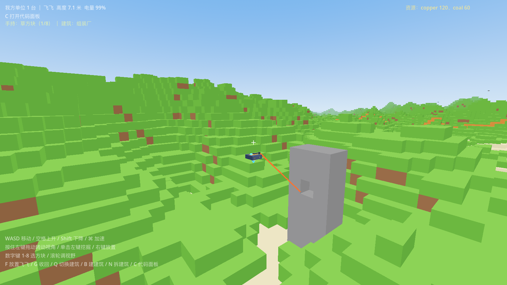
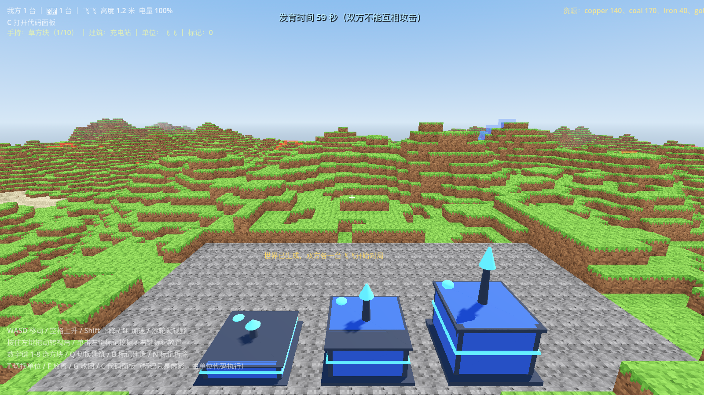
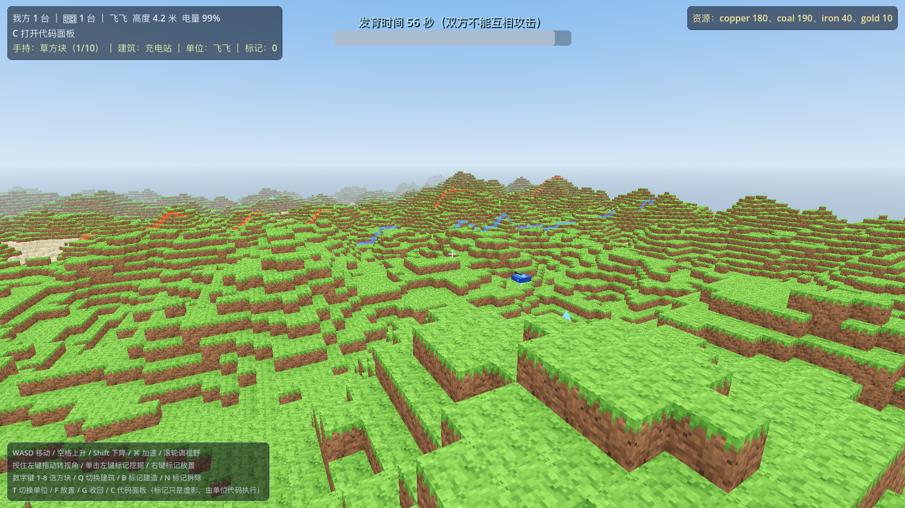
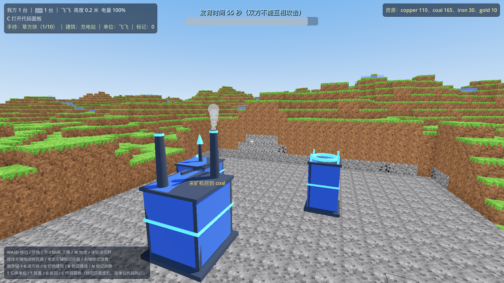
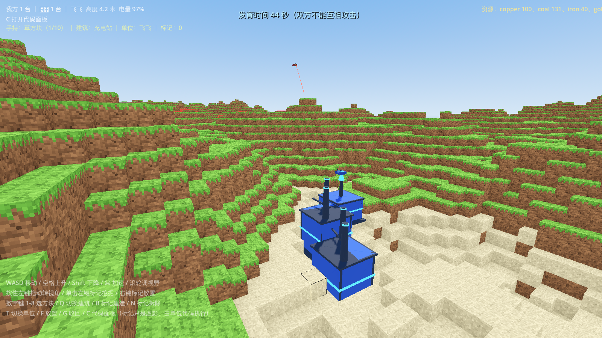
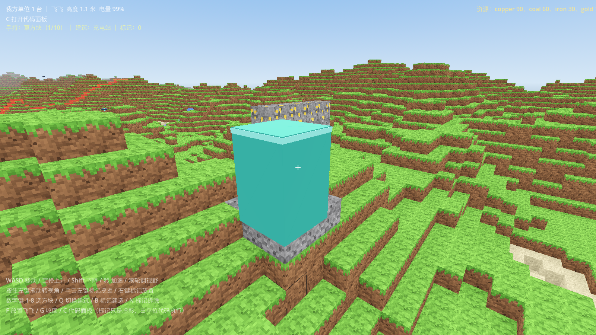
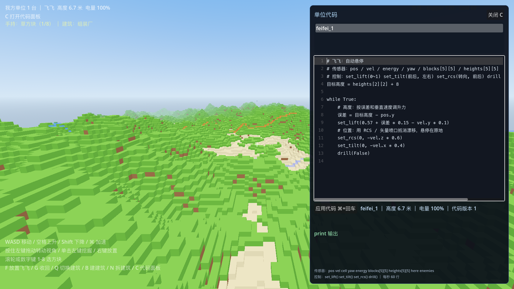
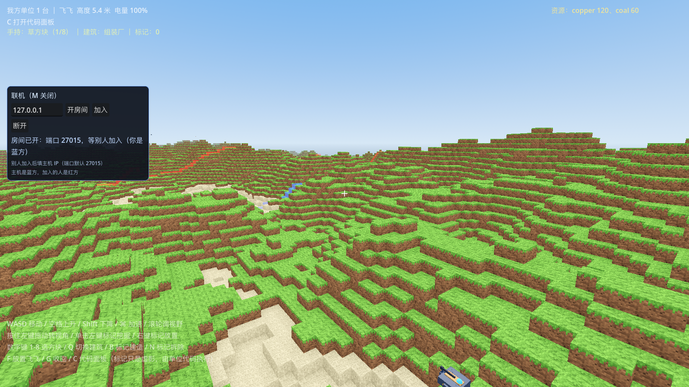
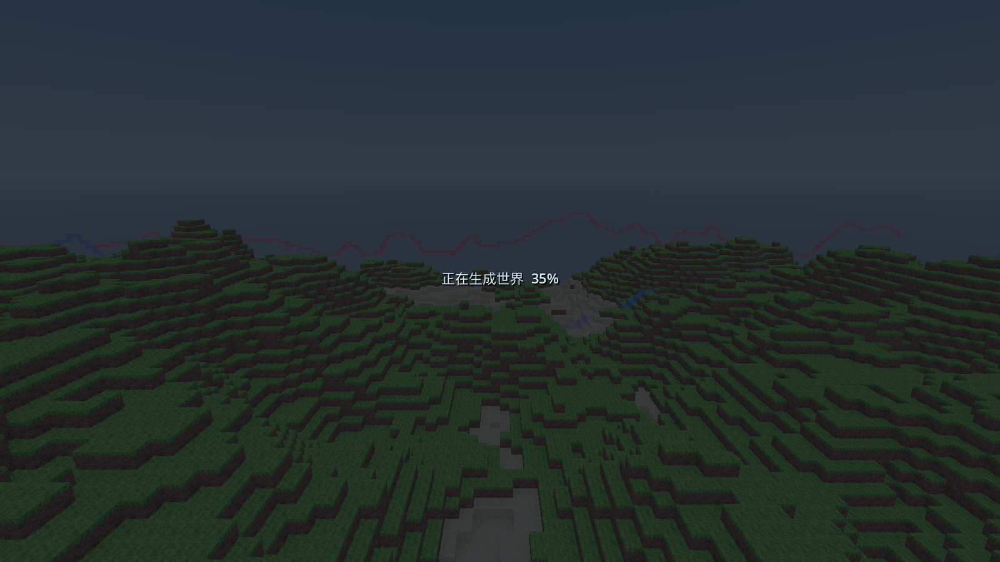
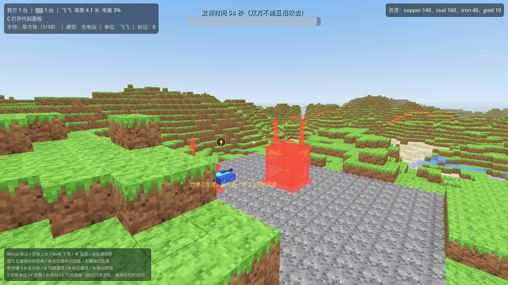
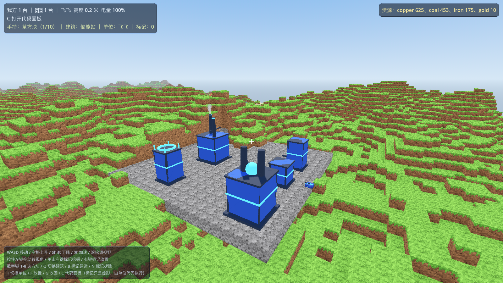
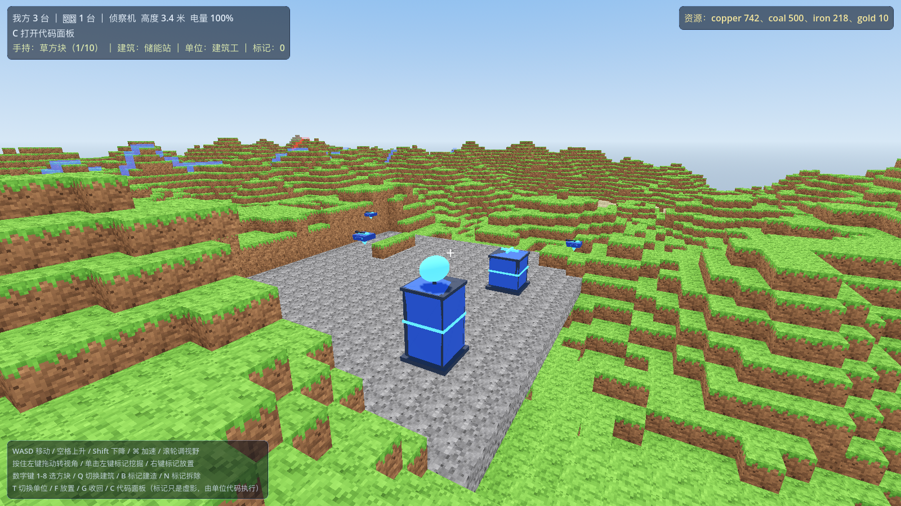

## 联机（M6 第一版）

按 **M** 打开联机面板：主机点「开房间」（默认 UDP 27015），加入方填主机 IP 点「加入」。主机跑全部模拟并把 20Hz 单位快照广播出去，加入方只做插值显示；客户端在代码面板里改的代码会发给主机执行。详见 `docs/联机怎么玩.md`。

## 性能优化（2026-11-08）

实测（256×256×64 全图、AMD Radeon Pro 5300 4GB）：

| 项目 | 优化前 | 优化后 |
| --- | --- | --- |
| 启动到可操作 | 4.5 秒（同步建完 256 区块，窗口卡死） | **0.81 秒**（按视野流式生成 + 加载进度提示） |
| 单区块重建 | 15.6 ms | **7.2 ms** |
| 最慢帧 | 22.0 ms | **14.8 ms** |
| 平均帧（关垂直同步） | 16.4 ms | **9.6 ms** |

做法：
- 方块网格重建改用摊平的 Packed 查找表（不再每次 `is_solid()/is_opaque()` 函数调用、数组套数组、逐顶点建 `Color`），AO 等级与面明暗预计算成 24 个顶点色。
- 改方块只标记区块脏，下一帧按「每帧 1 个区块 + 8ms 预算」重铺，避免一次挖矿同步重建多个区块卡帧。
- 材质集中缓存（`scripts/core/mat_cache.gd`），不再每次创建 `StandardMaterial3D` 触发管线编译。
- 启动不再同步建全图，改成视野流式生成 + 「正在生成世界 xx%」提示。
